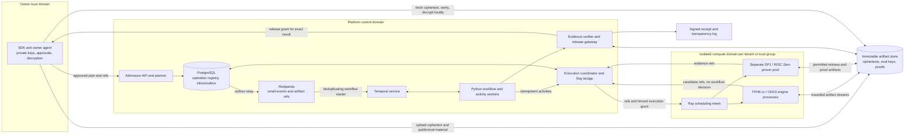

# Kryvola: Design v2

*Version 2.0 · 25 October 2026 · Proposed production architecture*

Companion: [Implementation Plan v2](kryvola-implementation-plan-v2.md). This document supersedes the architectural decisions in the two v1 documents. The supplied workspace contains those documents, not checkouts of the five named repositories; repository assignments below are proposed ownership, not assertions about implemented code. Performance numbers labelled **targets** are engineering gates, not measured results. Upstream versions, features, licences and security advisories must be recorded against exact commits before adoption.

## 1. Executive summary and architectural vision

Kryvola is a confidential data fabric for private inference, with a path to multi-party analytics and training. Its central contract is to execute an explicitly approved computation under a declared trust model while keeping private decryption keys outside the platform's compute and messaging domains. Protocol selection is a constrained optimization problem: privacy, correctness evidence, disclosure policy and numerical accuracy are hard constraints; cost and latency are optimized only among feasible plans.

The production baseline is deliberately narrow: one owner encrypts a bounded, quantized tabular workload; a TFHE-rs engine evaluates a public or otherwise worker-readable model; only the owner's agent decrypts the encrypted result. This gives input confidentiality under the selected FHE assumptions and declared leakage. It does **not** establish correctness against an actively malicious evaluator or guarantee that outputs hide the model. Requests requiring unsupported guarantees are rejected at admission.

The fabric separates five responsibilities:

1. **Redpanda** transports small, replayable admission and status events with artifact references.
2. **Temporal** owns the durable logical workflow, dependencies, deadlines, retry decisions and release authorization.
3. **Ray** schedules disposable compute executions and warm engine actors; it has no authority to advance workflow state or disclose results.
4. **An immutable artifact store and a PostgreSQL execution registry** make payloads and external effects recoverable across process and cluster failure.
5. **Owner agents and independently administered key domains** control encryption, decryption and disclosures; compute workers receive only the public/evaluation material allowed by their protocol.

FHE evaluation and zkVM proving are separate resource pools. Small supported FHE workloads can offer a bounded interactive service after benchmarking. Expensive FHE and all general-purpose proving use asynchronous jobs. Optional evidence can arrive later only when the caller explicitly permits it; required evidence blocks release. There is no promise of arbitrary real-time FHE inference or a proof for every ciphertext operation.

The long-term protocol-polymorphic vision remains, but each engine and each conversion edge must independently pass security, interoperability, numerical and operational gates. Using all six primitives is an extension portfolio, not a reason to place six cryptographic systems in the first release's critical path.

## 2. Critical review of v1 and decisions

| Finding in v1 | Failure or overclaim | v2 decision |
|---|---|---|
| Ray and Redpanda are absent; Temporal integration has no external-effect contract | A resubmitted activity can launch duplicate work or accept a stale result | Explicit events, operation registry, monotonically increasing fences and idempotent activities (§5) |
| Sequence numbers and nonces are called exactly-once execution | Replay detection cannot atomically cover a broker, workflow, scheduler and object store | At-least-once delivery/execution; at most one accepted result per logical operation; separate release deduplication |
| Storage is excluded from the hot path | Ray loss or a broken direct stream can destroy the only recoverable input/output | Durable input/output artifacts are the baseline; direct streams are an optimization backed by durable boundaries |
| Arrow/Flight imply end-to-end zero-copy and automatic GPU hand-off | Crypto libraries deserialize native structures; network and GPU transfers still copy | Opaque versioned native ciphertext bytes, bounded chunks, measured copies; CUDA IPC only within a validated host boundary |
| CKKS-to-TFHE switching is assumed to connect OpenFHE and TFHE-rs | Scheme names do not establish ciphertext, key or parameter compatibility | Separate engine profiles; no conversion until a reviewed adapter exists (§8) |
| Signed receipts, attestation and ZK statements are grouped as computation integrity | A signature authenticates a claim; a proof establishes only its encoded relation | Typed evidence requirements and an explicit guarantee matrix (§9) |
| Joint TFHE and threshold ABE custody are assumed from generic key shares | Backup splitting is not distributed key generation, issuance or decryption | Separate threshold integrations with exact quorum assumptions; ABE is optional (§7) |
| T1 promises input and model privacy under ordinary FHE | An authorized decryptor may learn circuit/model information; query extraction is also possible | First profile makes no model-hiding claim; circuit privacy and model disclosure need separate review |
| Leakage declarations arrive in Phase 3; audit is late | Early composition and metadata disclosure become implicit | Threat model and leakage contracts precede the first engine; review is continuous |
| Planner must beat the best single protocol on two models | An optimization can lose honestly; conversion costs can dominate | Planner may keep one protocol; select only feasible plans with measured end-to-end improvement |

These are architectural corrections, not evidence that an implementation has a vulnerability. The source documents are the only project material reviewed.

## 3. Workloads, guarantees and release scope

### 3.1 Supported profiles

| Profile | Data/trust boundary | Production condition |
|---|---|---|
| **FHE-Q1**: bounded quantized inference, TFHE-rs | Owner holds client secret; worker holds ciphertext and evaluation/server key; worker knows model | First releasable profile. Parameters, operator allowlist, quantization, overflow semantics, bootstrapping count and service envelope fixed per model |
| **FHE-A1**: approximate linear/low-depth inference, OpenFHE CKKS | Same owner/worker separation; approximate arithmetic | Independent extension with precision, depth, release-query and output-slot controls; no implied TFHE bridge |
| **MPC-P**: a named two-/three-party protocol | Separate administrative compute parties hold input shares | Protocol-specific corruption threshold, active/passive model, abort behavior, network and preprocessing trust declared |
| **ZK-S**: proof of a specific deterministic statement | Prover sees its witness; verifier sees public journal and proof | Approved guest, proof mode, keys, statement binding and evidence deadline; does not inherit FHE correctness |
| **TEE-H**: confidential hardware inference | Plaintext may exist inside an explicitly approved enclave | Independent hardware trust tier, attestation policy, revocation and release-gateway review |
| **PIR/PSI/ABE/DP** | Retrieval, alignment, artifact access and output privacy respectively | Optional capabilities with separate leakage and composition contracts |

Training, transformer-scale inference, arbitrary ONNX operators, arbitrary tenant code, automatic cross-protocol conversion, threshold TFHE and confidential GPU hand-off are not baseline promises. Unsupported operations, key contexts, proof relations or deadlines fail admission; the planner never silently weakens a trust requirement or decrypts as a fallback.

### 3.2 Plan contract

An approved immutable plan binds `tenant_id`, logical job identity, owner/consumer identities, model and compiled-program digests, input manifests, shape and quantization, arithmetic/error semantics, engine/image and key-context versions, resource limits, conversion edges, expected leakage, required evidence, output schema and release policy. Owners sign the plan approval with freshness and expiry. The platform signs its admission decision. An approval cannot be transferred to another model, key epoch or consumer.

Guarantees are orthogonal fields, not one ascending “trust tier”: `input_confidentiality`, `model_confidentiality`, `active_integrity`, `input_validity`, `witness_privacy`, `output_privacy`, `availability_assumptions`. For example, a ZK input-validity proof does not satisfy `active_integrity=FHE_EVALUATION_PROVEN`. The planner must produce a human-readable explanation for every accepted assumption and every rejected requirement.

## 4. Refined component topology and data flow

### 4.1 Topology



Arrows through Redpanda, Temporal, Ray scheduling and the registry contain descriptors, never bulk tensors, proof blobs, private keys or plaintext witnesses. Artifact transfer uses authenticated object APIs and optionally Flight; the same authorization and manifest validation applies to both. Interactive MPC/PSI traffic uses direct authenticated party channels, bypassing all three schedulers/brokers.

### 4.2 Exact baseline sequence

1. **Prepare at owner.** The SDK validates the model profile, creates/loads the key context inside the owner domain, quantizes and encrypts features, and optionally proves compact-encryption validity. It uploads immutable ciphertext and public/evaluation-key artifacts. The client secret is not serialized into a job or a Ray object.
2. **Publish artifacts.** The artifact service verifies the completed upload and signed manifest, commits an immutable version, and returns a non-secret `ArtifactRef`. A reference grants no read access. Large evaluation keys are uploaded once per key epoch and fetched into bounded worker caches.
3. **Admit.** The API authenticates the owner, verifies approval, size/shape/profile, quotas, key status and supported evidence requirements. It stores job identity, plan digest and an admission outbox event in one SQL transaction. A repeated client idempotency key with a different plan is a conflict. `202 Accepted` means durable admission, not completed inference.
4. **Start durable workflow.** An outbox relay publishes `JobAdmitted` to Redpanda. A starter uses a stable, opaque workflow ID derived from tenant and job identity. It records inbox deduplication only after Temporal confirms start or an existing matching workflow. Offset acknowledgement follows; a crash simply causes redelivery. Closed-job registry tombstones prevent a replay from creating another run after Temporal history retention.
5. **Validate inputs.** Temporal invokes activities to verify artifact availability, native conformance and required zk-pok before expensive expansion/evaluation. It records only bounded references and validation summaries. Public-key/context and nonce binding are checked separately from shape conformance.
6. **Dispatch.** A Temporal activity asks the coordinator to create or recover a stable operation and execution attempt. The coordinator commits an attempt/fence and dispatch intent; the bridge launches a Ray execution with references, deadline and scoped execution grant. Warm actors fetch allowed key material and invoke isolated Rust/C++ engine processes.
7. **Evaluate and commit.** The engine reads verified chunks, performs native bounded decoding, evaluates on CPU/GPU and uploads its encrypted output to an execution-specific staging path. The artifact service finalizes the immutable object. The coordinator validates output metadata/receipt, then selects a candidate by a current-fence SQL compare-and-swap. A Temporal activity returns the accepted output reference, not ciphertext bytes.
8. **Prove when applicable.** Temporal starts a separate operation for an approved SP1 guest or RISC Zero equivalent. The prover reads only the witness its trust profile permits. The verifier checks the exact statement and context. This can run concurrently with other independent DAG stages, but a result needing the evidence remains quarantined.
9. **Release.** Temporal confirms dependencies, accepted evidence and approval policy, then invokes an idempotent release activity. The gateway rechecks current authorization, revocation, fence/cancellation state and evidence, writes a unique release record and returns a grant bound to the exact encrypted output and consumer. The owner verifies and decrypts locally. Status events are emitted through an outbox.

A caller may wait on the same logical job within an interactive timeout and then continue polling that job asynchronously; timing out the HTTP request does not duplicate or cancel the computation. Result retrieval and status endpoints always enforce tenant authorization.

### 4.3 Component and repository ownership

| Repository | Languages and responsibility |
|---|---|
| `kryvola-spec` | Protobuf services, canonical signing schemas, Arrow chunk conventions, threat/leakage profiles, ADRs, golden and negative conformance vectors. Generates Rust/Python/C++ bindings |
| `kryvola-fabric` | Rust admission/artifact/session/coordinator/receipt services and owner agent; **Python Temporal workflows/activities and Python Ray bridge**, deployed separately. SDK choice is explicit; a production Rust Temporal SDK is not assumed |
| `kryvola-engines` | All engine implementations and adapters, including Rust TFHE-rs, SP1/RISC Zero guests/provers and PIR; C++ OpenFHE, SPU/PSI integrations and CUDA builds. Engine-specific native formats remain here |
| `kryvola-ml` | Python SDK bindings, model import and quantization, reference semantics, plan compiler, constrained cost model and optional DP accounting |
| `kryvola-platform` | Kubernetes/Helm/Terraform, Redpanda/Temporal/SQL/object-store deployments, isolated Ray pools, SPIRE, observability, benchmark/fault/security suites and coordinated release manifests |

Each repository depends on versioned spec contracts; platform pins a tested release set. Runtime services communicate through those contracts, not private imports across repositories. Engine interfaces are uniform operationally, but their capabilities, security assumptions and data types are not interchangeable by name alone. The chosen workflow implementation uses the documented [Temporal Python SDK](https://docs.temporal.io/develop/python).

## 5. Temporal, Ray and Redpanda consistency contract

### 5.1 Authority and durable state

| State | Authoritative owner | Explicit restriction |
|---|---|---|
| Logical DAG, dependencies, retry eligibility, deadlines, evidence policy and decision to release | Temporal history | Workflow code performs no network, native crypto, Ray calls or other nondeterministic I/O; those run in activities |
| Admission deduplication, physical execution attempts, fences, output selection, release grants, inbox/outbox | PostgreSQL via coordinator APIs | Registry cannot invent DAG transitions or retry a failed logical stage; it enforces workflow-issued intent and current safety predicates |
| Physical placement, ephemeral actor/cache state and local progress | Ray | No durable job status, sole output copy, key custody or release decision in actor memory or `ObjectRef` |
| Immutable input/output/proof bytes and manifests | Artifact store | Object existence is not workflow completion or authorization to disclose |
| Event ordering within a partition and consumer offsets | Redpanda | Events are notifications/requests; a forged or replayed completion event cannot complete an operation |

Temporal workflows must replay deterministically; external calls belong in activities. Ray actor restart reconstructs the constructor rather than restoring arbitrary application state, and retries can execute a method again. These vendor properties motivate the above authority split. [Temporal workflow constraints](https://github.com/temporalio/documentation/blob/main/docs/develop/python/workflows/basics.mdx), [Ray actor fault tolerance](https://docs.ray.io/en/latest/ray-core/fault_tolerance/actors.html).

### 5.2 Operation identity, leases and fences

Define `operation_id = H(tenant, logical_job_id, plan_digest, stage_id, workflow_epoch)`. `logical_job_id` and the application `workflow_epoch` persist across Temporal Continue-As-New runs and ordinary workflow/activity retries; the changing Temporal run ID is diagnostic. `workflow_epoch` starts at zero and changes only during an explicitly coordinated recovery/re-admission procedure that fences all old operations. Such a change preserves the logical job's admission/release tombstones and cannot authorize another disclosure. A workflow-authorized retry increments a durable `attempt_epoch`; every physical launch gets a separate `execution_id`. A lost dispatch acknowledgement can produce two physical launches for the same pure operation. Each writes a distinct staging object; neither overwrites another's output.

An operation row stores intent digest, current attempt/fence, DB-time lease expiry, owner/cluster identity, execution IDs, terminal/cancelled status and the selected output manifest. Unique constraints protect admission keys, operations and release records. Only the coordinator can mutate the registry; workers present a short-lived grant and cannot write SQL directly.

Finalization is one SQL transaction: validate grant and immutable artifact availability; check current epoch, unexpired lease, matching plan/inputs, no cancellation tombstone and no accepted output; select the candidate and append the completion outbox event. A stale worker may waste compute and upload an orphan; it cannot select an output. Duplicate finalization of the same selected digest returns that selection. Conflicting candidates are logged without assuming byte-identical output across randomized evaluations. After selection commits, expiry of the physical dispatch lease does not invalidate the selected artifact; subsequent evidence/release checks use the committed selection and current cancellation, recovery, key and policy epochs.

Release deduplication uses a stable disclosure identity `(tenant, logical_job_id, output_stage, recipient, disclosure_index)` independent of physical attempt and workflow epochs. Baseline requests have one disclosure index; a genuinely new authorized disclosure needs a new explicit index and, where applicable, a new DP budget reservation. A retried release returns the same committed grant record rather than minting another effect.

Leases bound dispatch ownership, not correctness. Revoking a lease fences its writes even if the process continues. Renewals use database time and a bounded operation deadline, and stop when workflow intent is cancelled. A lost dispatch acknowledgement under a live lease may cause bounded resubmission of that same pure-compute attempt. Once its lease expires, the epoch is irreversibly retired: old grants cannot renew or reacquire it, and `EnsureAttempt` returns `ATTEMPT_EXPIRED`. Temporal then explicitly decides whether to create a new epoch. Temporal activity retries first query the registry; a previously selected output is returned without relaunching. They never derive a new application attempt from the SDK's activity retry counter. New epochs require an explicit workflow decision.

There is no distributed transaction between SQL, Ray, Temporal and the object store. Safety comes from immutable artifacts, stable IDs and fenced acceptance; liveness comes from reconciliation. Only pure/restartable FHE/proof executions tolerate duplicate physical work. MPC/OT/FSS sessions reserve one-use preprocessing against a single execution ID and participant roster; ambiguity burns that material and a new workflow attempt uses a fresh session, nonce and randomness. Actor reconstruction must not reuse triples or FSS keys.

### 5.3 Delivery, retries, cancellation and recovery

| Fault window | Required behavior |
|---|---|
| Admission committed, event not published | Outbox relay retries; durable job is discoverable by reconciliation |
| Temporal start succeeds, starter dies before offset/inbox commit | Redelivery resolves the same workflow/job; does not restart a closed job |
| Ray launched, bridge/activity acknowledgement lost | Query stable operation; permit bounded duplicate pure compute with distinct execution IDs; exactly one selection CAS wins |
| Output uploaded, worker dies before finalization | Registry shows no accepted output; retry can validate/reuse only an explicitly recorded candidate or rerun; unreferenced objects expire later |
| Output selected, activity response lost | Activity retry reads selected manifest and returns it; no new side effect |
| Lease expires or Ray head/cluster is lost | Fence old attempts; Temporal decides recovery from durable input/checkpoint. Actors and ObjectRefs are disposable |
| Cancel races with completion/release | Cancel activity first writes tombstone and revokes execution grants/fences; then best-effort Ray cancel. A single locked registry transaction serializes cancellation against release. A grant issued first may already be consumed; cancellation cannot retract disclosed data |
| Proof late, invalid or unavailable | Required-evidence job stays unreleased and expires/fails; optional evidence status is updated without relabelling an unproven result as proven |
| Broker/SQL/object store unavailable | Backpressure or bounded retry; fail closed on new grants and release; do not switch to Ray-local authoritative state |
| Restore from backup | Establish a new cluster/recovery epoch, revoke old grants, reconcile Temporal and registry before enabling release; never accept pre-restore worker completions blindly |

The user cancellation API first commits the coordinator tombstone/fence and only then acknowledges effective cancellation and requests Temporal cancellation. If the registry is unavailable it reports cancellation pending, not `CANCELLED`. Workflow cancellation handlers use shielded cleanup; reconciliation completes fencing/cleanup if a worker is unavailable. Administrative Temporal termination must go through the same fencing procedure, and a reconciler fences orphaned/terminated workflows before any further release. Direct service access that bypasses this administrative path is restricted. No public cancellation acknowledgement may precede the registry barrier.

Long activities heartbeat bounded operation/checkpoint references, use schedule/start/heartbeat timeouts and exponential backoff, and classify permanent cryptographic errors as non-retryable. Heartbeat indicates liveness, not verified computation. A durable polling activity/reconciler remains the correctness path if a completion notification is lost. Workflow history is bounded with batches/child workflows and Continue-As-New; no workflow per streaming sample.

Redpanda uses replication factor 3 across failure domains for the initial deployment, `acks=all` under validated broker durability settings, idempotent producers, TLS/SASL, ACLs, bounded retention and explicit backpressure. Partition by opaque tenant/job or stream-window identity; rely only on ordering within that partition. Events carry `event_id`, `causation_id`, schema version and aggregate sequence. Consumers deduplicate by event ID, validate sequence/version against the registry, quarantine poison records with sanitized diagnostics, and acknowledge only after durable handling. Broker transactions can make broker-local consume/produce atomic; they do not make this whole system exactly-once. [Redpanda transactions](https://docs.redpanda.com/streaming/current/develop/transactions/).

## 6. Data serialization and protocol specifications

### 6.1 Control plane versus bulk plane

The following are initial **Kryvola limits**, intentionally below vendor maxima. They are configurable only within a reviewed profile; exceeding one rejects the request before allocation.

| Boundary | Encoding | Initial application limit and rule |
|---|---|---|
| API/engine/coordinator control RPC | Versioned Protobuf over authenticated gRPC | 64 KiB decoded control message; all large lists become manifest references |
| Redpanda record | Protobuf event envelope | 64 KiB including headers; no ciphertext, proof or witness bytes |
| Temporal argument/result/heartbeat/failure detail | Protobuf-compatible bounded DTO | 32 KiB per logical payload and 128 KiB aggregate per application call; errors/logs sanitized; no credentials or signed download URLs |
| Ray task/actor argument and return | Validated descriptor DTO and artifact refs | 64 KiB control data; never pickle external client objects or embed ciphertext vectors |
| Artifact manifest | Canonical signed document | 1 MiB manifest cap; shard index manifests when necessary; control paths carry its digest/reference only |
| Bulk transfer | Opaque native serialization in chunks | 1 MiB default, maximum 4 MiB chunk body; negotiated transport frame headroom; bounded in-flight byte window |
| Whole artifact / expanded tensor / key cache | Profile-specific declared byte counts | Admission checks serialized and expanded CPU/GPU sizes independently; initial test profile permits up to 1 GiB artifact, not arbitrary allocation |

Temporal records activity/workflow payloads in history, so claim-check references are required even if an SDK offers compression or encryption. Application guards must cover failures, signals, search attributes and heartbeats as well as function arguments. [Temporal worker data handling](https://docs.temporal.io/best-practices/worker), [Temporal payload-limit troubleshooting](https://docs.temporal.io/troubleshooting).

Cap'n Proto is not introduced alongside Protobuf in v2: a second control IDL increases interoperability and signing complexity without removing crypto decoding costs. Protobuf is not the canonical signing representation; its deterministic encoding is explicitly not canonical. [Protobuf serialization guidance](https://protobuf.dev/programming-guides/serialization-not-canonical/).

### 6.2 Normative logical schemas

The spec repository must publish machine-readable schemas and byte-exact vectors for at least:

```text
ArtifactRef {
  opaque_artifact_id, tenant_scope, immutable_version, manifest_digest,
  byte_length, media_type, schema_version
} // no bearer token, bucket credential, private key or expiring URL

ArtifactManifest {
  version, tenant_scope, artifact_kind, producer_identity, key_context_digest,
  native_codec_id, native_codec_version, parameter_set_digest,
  dtype, shape[], quantization_or_scale, protocol_metadata,
  serialized_bytes, max_expanded_bytes, ordered_chunk_entries[], full_blob_digest
} // signature envelope is outside the manifest payload

ChunkEntry { index, byte_offset, byte_length, chunk_digest }
ExecutionSpec {
  operation_id, attempt_epoch, execution_id, fence, plan_digest,
  stage_id, program_digest, engine_digest, input_refs[], output_contract_ref,
  key_context_ref, deadline, resource_profile, evidence_policy_ref
} // grants supplied separately over authenticated RPC

StageReceipt {
  version, tenant_scope, logical_job_id, operation_id, attempt_epoch, execution_id,
  fence, plan_digest, engine_digest, program_digest, input_manifest_digests[],
  output_manifest_digests[], key_context_digest, capability_profile_digest,
  leakage_profile_digest, evidence_refs[], evidence_status, signer, times
}
```

`protocol_metadata` is a versioned tagged union: CKKS records modulus chain/level, slots and scale; TFHE records radix width, message/carry parameters and serialization type; MPC records party/session/share identity and preprocessing reservation. Untrusted metadata cannot select arbitrary library parameters. The receiver matches it to an allowlisted immutable profile before decoding. No native structure is portable merely because both sides call it “TFHE” or “CKKS.”

### 6.3 Canonical hashes, signatures and authentication

Use [RFC 8785 JCS](https://www.rfc-editor.org/rfc/rfc8785) UTF-8 for signed manifest, approval, key-context, journal and receipt payloads, with a strict Kryvola schema: no duplicate/unknown fields for a signed schema version, no floating-point fields, exact large integers and decimals encoded as specified strings, lowercase fixed-length hexadecimal digests, fixed enum strings and base64url without padding for binary fields. Reject noncanonical encodings; preserve string bytes without silent normalization. A new signed field requires a new schema version and vectors, even if the surrounding RPC evolves additively.

Define domain-separated BLAKE3-256 hashes for each artifact type. For example, `manifest_digest = BLAKE3("kryvola/manifest/v1\0" || canonical_manifest_payload)`; the signature binds a distinct receipt/manifest/approval domain plus the canonical payload. The initial signature profile is Ed25519 with independently authenticated identity/key IDs and rotation history; this profile makes no end-to-end post-quantum claim. The full blob hash covers the exact serialized bytes. Ordered chunk digests bind index and length as fixed-width unsigned little-endian integers plus chunk bytes, using their own domain tag. A manifest digest thereby binds ordering, lengths, codec, key context and total bytes as well as chunk content.

A consumer first authenticates the signed manifest against the expected producer/owner and the plan, then verifies each chunk and the reconstructed total. A hash by itself is not authorization or producer authenticity. Merkle/Bao streaming is optional if its tree/proof format is specified and fuzzed; the baseline ordered chunk manifest is sufficient. Do not call a digest of low-entropy plaintext a hiding commitment. Plaintext-related public statements need a reviewed hiding commitment/salt protocol; private feature hashes must not become public metadata accidentally.

### 6.4 Native payloads, Arrow and transfer behavior

TFHE-rs objects use its versioned safe serialization and bounded conformant decoding; enforce the profile's list length/type and resource bounds before expansion. Native codec version and engine release set are pinned. Parameter conformance does **not** establish that a ciphertext and server key belong to the same owner key: Zama explicitly documents this limitation. Check owner-signed context binding and, when supported/required, a compact-encryption proof bound to that context/public key. [TFHE-rs serialization](https://docs.zama.org/tfhe-rs/fhe-computation/data-handling/serialization).

Arrow is a batching and transport envelope, not a reimplementation of cryptographic layouts. A Flight batch has columns `artifact_id`, `chunk_index:uint64`, `byte_offset:uint64`, `chunk_digest:fixed_size_binary[32]`, `payload:large_binary`, plus the immutable manifest digest. Each row contains one bounded chunk; avoid a single multi-gigabyte Arrow cell or a Python list of individual ciphertext objects. The initial profile permits one chunk row per batch, at most 5 MiB for both encoded and decoded batch/message bytes (including at most 64 KiB metadata), an 8 MiB in-flight transfer window per stream and at most eight concurrent streams per worker. Transport limits are explicitly configured for that frame size; no unbounded Arrow compression/decompression is accepted. Validate frame/row/offset limits and reserve aggregate buffer memory before Arrow/native decoding; profile-specific hardware quotas may lower these maxima. The signed manifest, not mutable Arrow metadata, defines cryptographic semantics. Reassembly supports aligned byte-range resume; a reconnect reauthorizes and reverifies each chunk. Whole native objects may require complete reassembly and decoding before compute can start: transport streaming alone does not imply streaming FHE evaluation.

Use Flight `DoPut`/`DoGet`, or a bounded gRPC byte stream/object multipart API when Arrow would add needless overhead. Server-selected parallel endpoints require explicit chunk ordering in the receiver. Flight is built on gRPC and Arrow IPC and offers copy-reduction opportunities, not a universal no-copy guarantee. [Arrow Flight protocol](https://arrow.apache.org/docs/format/Flight.html).

The baseline transport is TLS 1.3 with mTLS workload identity and per-artifact authorization; use SPIFFE/SPIRE where deployed. Same-host Unix sockets/shared memory can reduce copies. CUDA IPC handles are scoped to a host, driver/runtime compatibility and isolation boundary and are never durable references. GPU eviction, process restart or host change falls back to a measured host/object transfer. No RDMA or GPUDirect path may bypass identity, isolation or integrity checks; enable it only after hardware-specific validation.

### 6.5 Artifact authorization, persistence and collection

All artifact bytes are committed immutably before a stage becomes recoverable. Uploads use execution-scoped temporary paths and multipart checks; finalization verifies hashes/lengths and publishes a manifest without relying on an atomic rename. The selected S3-compatible backend must pass immutable-version, consistency, conditional-write, range-read, deletion and fault-injection tests. SQL references a committed artifact only after durable finalization. Missing artifacts cause retry/quarantine, never success.

Artifact services issue short-lived read/write grants after mTLS identity, tenant, operation/fence, purpose and revocation checks. Consumer/owner reads of a quarantined output additionally require the unique committed release record for that exact artifact, recipient and policy epoch; generic tenant membership or knowledge of its reference cannot bypass evidence gating. Internal compute and evidence reads have distinct purpose-scoped permissions and cannot mint consumer grants. Refs never contain long-lived capabilities; workers cannot list other tenants' objects or obtain arbitrary URLs (avoid SSRF). Raw bucket access is restricted; signed URLs, if an adapter needs them, stay in ephemeral activity/worker memory and expire quickly. Object-store encryption-at-rest keys are separate from FHE decryption keys.

Pin inputs, outputs, evidence and checkpoints while referenced by live workflows or release retention. Collect abandoned staging uploads and unselected outputs only after a grace period covering lease expiry, retries, event replay and restore procedures. GC reconciles registry pins and manifests, not Ray reference counts. Cache and dedup scope includes tenant/key epoch; no global cross-tenant dedup or existence oracle. Revocation stops new grants and purges caches, but cannot erase material already copied by a previously authorized party.

## 7. Security and key management

### 7.1 Key custody invariants

| Material | Allowed location | Forbidden location |
|---|---|---|
| FHE client secret / threshold private decryption shares | Owner agent; approved independent key-party service | Ray processes/nodes, Redpanda, Temporal/history, shared object buckets, platform diagnostics |
| Public encryption and evaluation/server keys | Versioned public/evaluation registry, bounded worker caches | Must never be mistaken for decryption authority; distribution remains tenant/purpose scoped |
| Workload identity and receipt signing keys | Short-lived workload identity; isolated signing facility with limited purpose | Raw secrets in workflow args/events, unrestricted engine code |
| ABE master secret and user attribute keys | Reviewed authority and authorized consumers | Engine workers or broker; backup sharing alone is not threshold issuance |
| MPC input shares / one-use preprocessing | One approved party domain each, with protocol-specific handling | A common Ray cluster or shared administrator that sees all parties' shares |

The TFHE-rs `ServerKey` is evaluation material, not a client decryption key. Its size and derived secret structure still require controlled distribution and a library-specific security review. Key contexts contain only public/evaluation material, parameter and proof-key IDs, owner signatures, validity interval, recipient/committee metadata and revocation epoch. Private key generation and decryption APIs exist only in separately built owner/key-party components; compute images expose neither operation.

TFHE compact-encryption proofs have their own setup lifecycle, separate from zkVM ceremonies. The evidence profile pins the approved `CompactPkeCrs` artifact digest, proof-scheme/library version, parameter/list-size limits, setup procedure/provenance and authorized issuer. The cryptographic review determines the exact setup/randomness assumptions and generation process for the adopted version. Clients/verifiers reject caller-selected, unknown, malformed, oversized or mismatched CRS artifacts; rotation creates a new evidence profile and preserves the verification policy for retained proofs. Reference possession alone cannot select trusted proof parameters.

Owner agents run outside the platform trust domain, use encrypted local storage and OS/process isolation, disable dumps, avoid swap where feasible, and minimize/zeroize secret copies. HSM/KMS custody is used only where the actual FHE operations are supported; wrapping an FHE key at rest does not keep it out of agent RAM during use. Platform workloads have no owner-agent decrypt RPC route. The owner agent independently verifies the approved plan, output digest, consumer, freshness and required evidence before any disclosure.

For basic FHE, valid digests and signatures still do not establish honest evaluation. FHE is malleable: a malicious worker can return a crafted ciphertext. There is no automatic service that decrypts arbitrary worker output and returns plaintext, success detail or a useful error oracle. Bound output queries and downstream observable feedback; actively malicious requirements need a reviewed evaluation-verification/MPC/TEE profile or are rejected. CKKS additionally needs reviewed shared-decryption/noise-flooding parameters and masking of unused SIMD slots before release; the OpenFHE security notes explicitly identify these risks. [OpenFHE security notes](https://openfhe-development.readthedocs.io/en/latest/sphinx_rsts/intro/security.html).

### 7.2 Rotation, threshold systems and ABE

Key epochs are immutable. New sessions pin a current epoch; rotation does not silently make old ciphertexts compatible with new evaluation keys. Old data needs owner-side re-encryption or an independently validated key-switch protocol; it is never decrypted on Ray for migration. Revoke compromised epochs, stop admission/release/grants, fence affected operations, and obtain fresh approval. Backup recovery tests run inside the owner/key-party domain.

Threshold deployments must name `(n,t)`, corruption bound, collusion model, liveness/abort rules, DKG/resharing protocol, share verification and independent operators. Availability tolerates at most `n-t` absent parties for a `t`-of-`n` decryption policy; secrecy depends on fewer than the approved corruption threshold colluding and the specific protocol assumptions. Do not conflate these two properties. No full key is reconstructed in the platform.

TFHE-rs-compatible threshold operations have a separate [Zama KMS project](https://github.com/zama-ai/kms); they are not implied by a local TFHE-rs adapter. Its documented deployment assumptions include external protection of its gRPC interface. Any integration requires an authenticated release gateway, network denial from Ray/brokers, exact parameter compatibility and an independent distributed-protocol review. Likewise, threshold OpenFHE release is a distinct profile.

ABE remains optional envelope access control for artifacts a trusted endpoint is entitled to open. A random DEK encrypts a plaintext-bearing artifact with authenticated symmetric encryption; ABE wraps that DEK. This does not hide model weights from the endpoint that opens them, add FHE correctness, or retroactively revoke an already learned DEK. Covercrypt policy expressiveness, implementation licence, authority compromise, issuance/audit and epoch rotation require a spike and review. V2 assumes a centralized authority in its own trust domain unless an actual distributed issuance protocol is selected and reviewed; it does not claim threshold ABE from split backups.

### 7.3 Isolation and side channels

Ray executes trusted application code; it is not a hostile-tenant sandbox. Use separate Ray clusters and Kubernetes/service-account/network boundaries for tenants requiring isolation and separate administrative domains for MPC parties. Do not use Ray namespaces or GPU resource labels as security boundaries. Expose neither dashboard/jobs nor native control ports publicly; restrict them to authenticated management. [Ray security model](https://docs.ray.io/en/latest/ray-security/index.html).

Use default-deny network policy, scoped artifact grants, digest-pinned allowlisted engine programs, read-only filesystems, seccomp/capability limits, egress restrictions and isolated scratch volumes. Arbitrary Python/pickle deserialization from a caller is forbidden. Rust bounded parsers and sandboxed native sidecars reduce blast radius but do not eliminate native library bugs. Worker signing keys identify workers; they cannot mint owner approval or release authority.

Timing, access patterns, traffic size, key-context reuse and GPU cache/memory behavior remain observable. Bound and document public shapes, pad to approved buckets when needed, use fixed public execution schedules where practical, isolate sensitive GPU/CPU tenants, scrub reuse buffers and restrict profilers/debug/dumps. Owner/key-party and prover implementations need side-channel review; no blanket constant-time guarantee is made for Rust/C++/CUDA libraries. TEE evidence is bound to nonce, image, policy and channel key, checked for freshness/revocation; it does not itself rule out microarchitectural leakage, rollback or host denial of service.

## 8. Cryptographic computation and protocol composition

### 8.1 FHE costs and correctness budgets

TFHE ciphertext expansion is measured for each integer width, packing/compact-list form, batch shape and parameter set. A compact upload can expand by a large factor into CPU/GPU working memory. Admission reserves expanded memory, evaluation-key residency, scratch space and bootstrapping capacity, not just wire bytes. Decode, verify, expand, transfer, key-load and evaluate times are separate benchmark metrics. No compression ratio is assumed for high-entropy ciphertexts.

The baseline FHE confidentiality parameter target is at least 128-bit classical security under the reviewed estimation methodology; record the estimator/version, attack model and parameter evidence rather than treating that label as a proof. M0 fixes exact parameters and an explicit total correctness-failure budget for the selected workload and deployment volume. Proof systems, signatures, transport and optional protocols have separately reviewed effective security; a 128-bit FHE target is not an end-to-end security claim for their composition.

TFHE programmable bootstrapping refreshes noise for supported operations but has substantial latency. Radix blocks, message/carry capacity, unchecked versus checked operations, bit width and carry propagation affect both cost and correctness. Compile only supported quantized operators and specify saturation/wrap/overflow rules; reducing precision requires model-owner approval and accuracy validation. Parameters include a total failure-probability budget across the operation count and expected deployment volume; a small per-bootstrap failure probability is not a whole-service guarantee.

CKKS profiles record packing, scale, modulus chain, multiplicative depth, rescaling, key-switching and bootstrapping schedule, and numerical-error bounds against an agreed reference. Bootstrapping does not recover precision already lost by approximation. Slot masking and disclosure protections consume levels/cost and belong in the compiled plan. Parameter tuning may not lower the approved security target to meet a deadline.

Evaluation-key and compiled-program caches are indexed by tenant, key-context/parameter/engine digest and program digest, with bounded CPU/GPU residency, eviction metrics and revocation. Batch compatible requests only within approved tenant/key/model/parameter contexts, with maximum batching delay and fairness quotas. Encrypted-result caching is opt-in and keyed by the exact input ciphertext manifest plus plan/key/evidence policy; randomized re-encryption limits hits. Never invent plaintext-based cross-request cache keys or reuse DP noise/release authorizations unsafely.

### 8.2 Conversion gates

OpenFHE documents CKKS/FHEW switching in its own subsystem; that is not a native interoperability contract with TFHE-rs ciphertexts. [OpenFHE scheme-switching example](https://github.com/openfheorg/openfhe-development/blob/main/src/pke/examples/scheme-switching.cpp). Each CKKS↔TFHE, HE↔MPC, PSI→MPC or consumer-key transition requires an adapter with:

- A precise input/output type and key relationship, public transcript and leakage specification, and any added trusted/interactive parties.
- A review of parameter/security compatibility, rounding/range/overflow behavior and failure probability; no hidden owner decryption/re-encryption step.
- Correctness vectors and negative tests for wrong key/epoch, malformed inputs, malicious participant behavior where claimed, abort and replay.
- Measured serialization, network, conversion and key-transfer cost included in routing; the entire path must beat or otherwise justify the approved baseline.

If a gate fails, the edge is unavailable. The planner can choose a single supported protocol or reject the workload. Research GPU FSS/dealers, FIDESlib, HEIR, Concrete ML and zkML engines remain behind the same per-capability gate. Packaging them behind an API does not make their parameter sets, security models or licences interchangeable.

### 8.3 PSI, PIR, MPC and DP boundaries

PSI declares exactly who learns membership, intersection identities/cardinality, input sizes, duplicates and order. “Only the intersection leaks” is not a general guarantee. PSI output should be secret-shared alignment indices when supported, or require explicit owner approval for revealed alignment. MPC declares corruption assumptions per concrete protocol, prevents a common administrator from collecting parties' state, and burns one-use preprocessing on ambiguous restart. Party share stores and read-grant authorities are independently administered; the shared orchestration layer sees descriptors/transcripts only and cannot issue itself access to all shares.

PIR hides query content only under the chosen scheme's assumptions; it need not hide table size, query timing/count or provide symmetric database privacy. Server logs lacking a query string are not a security proof. Pin a signed database snapshot/version; review client verification, updates, rate limits and cross-request access-pattern leakage. Private nearest-neighbor search is a separate supported capability, not a property inherited from basic PIR.

Differential privacy is an optional, explicitly budgeted release mechanism. Record adjacency, clipping, noise mechanism, sampler and accountant version, epsilon/delta, composition scope and utility tests. A trusted endpoint or approved MPC mechanism must generate hidden noise; a malicious evaluator choosing zero noise cannot be trusted to enforce DP. Use a durable privacy ledger keyed by logical release, reserve budget before disclosure and deduplicate retries so repeated releases do not spend/claim the wrong budget. DP does not repair a broken underlying confidentiality protocol.

## 9. Proofs, receipts and release guarantees

### 9.1 Evidence semantics

| Evidence | Establishes | Does not establish |
|---|---|---|
| TLS/manifest authentication | Authorized peer and intact referenced bytes | Honest evaluation or valid real-world input |
| Worker-signed stage receipt | Which identity claimed a particular program/input/output binding | Mathematical correctness; uncompromised signer |
| TFHE-rs zk-pok for approved compact lists | Supported well-formed encryption relation under selected parameters and bound public context | Truth of measurements, arbitrary business predicates or correctness of FHE evaluation |
| Approved zkVM proof | Exact relation computed by the pinned guest over the bound inputs/journal | An external native FHE/CUDA call was executed correctly unless the proved relation actually verifies it |
| Successfully completed approved malicious-secure MPC protocol | Protocol-specific active-security guarantee to its participants under its corruption and abort assumptions | Publicly transferable proof, security beyond its threshold or honest real-world data provenance |
| TEE quote plus verified runtime evidence | Approved measured environment under hardware/vendor assumptions | Purely cryptographic correctness, universal side-channel resistance or availability |
| Merkle log inclusion and consistency | Recorded receipt inclusion and append consistency against witnessed checkpoints | Truth of a receipt or freedom from split views without checkpoint comparison |

An external consumer relying on an MPC result must explicitly trust the named participant/committee attestations or require a separately specified public computation proof. A signed MPC receipt cannot automatically satisfy a public-proof requirement. Dual execution can detect some faults but not colluding workers, and byte comparison is not universally valid for randomized crypto/GPU computations. It is an optional diagnostic with a specified comparison relation, never a substitute for a claimed active-security guarantee.

### 9.2 SP1/RISC Zero integration

Use SP1 first for a bounded Rust guest proving, for example, correct aggregation/filtering of authenticated **public metadata** or a declared commitment relation. Never call a proof of receipt hashes a proof of encrypted inference. The guest validates all untrusted hints/witness data in constrained computation, verifies any required input signatures/commitment openings, and recomputes the relation rather than echoing prover-supplied roots.

The public journal binds `statement_id/version`, tenant/job or privacy-preserving job binding, operation/epoch, plan/model/program digest, ordered input/output commitment roots, key-context digest, policy digest, nonce and outcome. The verifier obtains expected values independently from the approved plan/registry and compares every field, then checks the pinned program verification key, verifier/proof-system version, proof mode, successful exit and any recursive assumptions/deferred proofs. Proofs for a different tenant, model, input order, epoch or policy fail even if cryptographically valid.

Proof privacy is mode-specific. SP1 documents that its individual STARK proofs are not currently zero-knowledge; its Groth16/PLONK implementations provide ZK and add their setup/security assumptions. Private-witness export requires a reviewed ZK mode, pinned ceremony/circuit/verifier artifacts and no intermediate trace/proof leakage. Public-data-only proofs may use an approved non-ZK mode, labelled accordingly. Do not assume a universal 128-bit or post-quantum guarantee for a composed proof stack; record the reviewed effective security of the exact version and mode. Production must reject mock/dev proofs and incomplete recursive verification. [SP1 security model](https://docs.succinct.xyz/docs/sp1/security/security-model).

RISC Zero is a separately pinned alternative for the same relation and public-journal contract. Verify its expected image ID, journal, success and fully resolved assumptions under the approved receipt type; do not apply SP1's proof-mode properties to it. Backends do not share binary proof formats or verification keys. [RISC Zero proof/receipt model](https://dev.risczero.com/proof-system/).

Zero knowledge protects a witness from a verifier, not from the prover holding it. Untrusted Ray proving pools may receive ciphertexts/public metadata only. Proofs over owner plaintext run in the owner domain or an explicitly approved private-prover/TEE domain with a separate witness path. A public prover network is not the default destination. Witnesses, dumps and traces never enter Redpanda or Temporal.

### 9.3 Asynchronous evidence and release

Evidence policy is an immutable list of required statement types and verifier profiles plus `REQUIRED_BEFORE_RELEASE`, `OPTIONAL_LATER` or explicitly `NONE`. Required input validity precedes compute; required output evidence precedes release. An unsupported statement, such as a general proof of TFHE-rs evaluation, fails admission. A late proof never retroactively makes an earlier release satisfy a requirement that was mandatory at release time.

Dedicated prover queues/pools have cycle, witness-size, memory, deadline and cost limits. Prebuild guest binaries/keys; cache **verification** by proof digest, verifier/program version and exact public statement. Proof/result reuse requires the identical full statement, key/policy epoch and authorization; per-job nonces usually prevent cross-job proof reuse. Aggregate proofs only with a specified membership/root/order contract, bounded batching delay and complete recursive verification. Bound retry budgets so slow or impossible proofs cannot consume inference capacity indefinitely.

Public result status distinguishes `COMPUTE_SELECTED`, `EVIDENCE_PENDING`, `EVIDENCE_VERIFIED`, `RELEASED`, `EVIDENCE_FAILED`, `CANCELLED` and `EXPIRED`. The registry stores physical state and release effects; Temporal alone chooses logical transitions. Evidence verification is an unprivileged, resource-limited service and cannot itself decrypt or mint owner approval.

## 10. Threat model and security guarantees

### 10.1 Adversaries and assumptions

Assume a network attacker, compromised broker/storage node, malicious or crashed compute worker, replaying client, resource-exhaustion input and an operator able to observe platform metadata. Plaintext confidentiality depends on the chosen cryptographic scheme/parameters and correct client implementation; active malicious behavior is handled only by profiles explicitly providing it. The platform control plane is trusted for authorization and release-policy enforcement in the baseline, while owners independently verify approvals/evidence. A compromised control plane can deny service or misroute ciphertexts and metadata; it must still lack private decryption keys.

Owners are trusted with their own plaintext/keys but may submit false data. Consumers are trusted with legitimately disclosed results and can copy them. MPC/key-party independence is a deployment assumption that must be evidenced; putting three pods in one administrator's cluster is not three independent parties. TEE deployments add CPU/GPU/firmware/vendor/attestation-root assumptions. External verifier availability is not guaranteed by ZK soundness.

### 10.2 Attack/mitigation/limit matrix

| Attack | Required mitigation | Residual limit |
|---|---|---|
| Worker steals data/key material | Only ciphertext and scoped evaluation material; egress/tenant isolation; no decrypt API or key-domain route | Metadata leakage, library flaws and endpoint compromise remain |
| Worker fabricates output | Required approved correctness evidence or reject the policy; basic FHE output explicitly unproven | FHE alone and signed receipts cannot detect arbitrary malicious evaluation |
| Payload substitution, truncation, chunk reorder | Authenticated canonical manifest, context binding, per-chunk and total verification, immutable versions | An authorized malicious producer can sign bad data; validity needs its own relation |
| Replay/stale completion | Admission/event deduplication, nonce, epochs, deadline, DB fencing and unique release record | Physical work may repeat; previously disclosed data cannot be retracted |
| Malformed crypto payload / resource bomb | Size/depth/shape limits, conformant bounded decoder, sandbox, pre-expansion memory reservation, fuzzing | Parser/conformance checks do not prove semantic validity or key ownership |
| Chosen-ciphertext/decryption oracle | No arbitrary remote decryption, bounded approved disclosure, no worker feedback, protocol-specific active defenses | Digests/approvals alone cannot certify honest FHE evaluation; dependent observable behavior needs review |
| Cross-tenant or MPC-party compromise | Separate clusters/trust domains; grants scoped to exact artifacts/attempts | A common privileged administrator defeats claimed party independence |
| Timing, access pattern, GPU/CPU side channels | Padding/profile disclosure, dedicated pools as required, buffer/dump controls and implementation review | Constant-time execution and all microarchitectural attacks are not guaranteed |
| Proof substitution or witness leakage | Expected journal/key/program checks, approved proof mode, witness-domain restriction | Proof-system/guest/setup flaws and witness exposure to its prover remain |
| Model extraction or sensitive output | Output-policy/query controls; separately reviewed circuit/model privacy; DP when applicable | Authorized results intrinsically disclose information; no generic model secrecy claim |
| Log equivocation or signing-key compromise | Independently witnessed checkpoints, consistency checks, rotation/revocation and constrained signer | Log inclusion is not computation correctness; past signatures need compromise-time analysis |
| DoS, party abort, regional failure | Quotas, fair scheduling, bounded retries, backups, capacity and recovery drills | Crypto does not guarantee availability or fairness |

The privacy report lists shapes, parameter IDs, model/stage graph where visible, ciphertext/proof sizes, timing and access patterns, key reuse, PSI intersection disclosures, PIR query count and output leakage. Padding choices and their cost appear in the plan. Security claims and exclusions are machine-readable capability fields and visible in result receipts.

## 11. Performance and scalability

### 11.1 Latency classes and admission

Use separate service classes with separately measured SLOs:

- **Interactive encrypted inference:** a small allowlisted FHE-Q1/FHE-A1 profile with warm keys; no general zkVM proof on its synchronous path. Required input proofs still count in end-to-end latency. If the approved profile cannot meet its deadline, reject or offer an explicitly chosen asynchronous class.
- **Asynchronous private compute:** larger batches/graphs; durable progress, per-tenant queues and bounded checkpoint/restart cost.
- **Asynchronous proving:** independent pool; proof readiness/failure SLO, witness/cycle budget and maximum evidence wait. Required evidence delays release even when compute is fast.
- **Streaming ingestion:** bounded encrypted windows/microbatches with event-time/watermark/late-data policy; one workflow per bounded window/batch group, not per record. Window updates produce new immutable input versions and new operations; no mutating committed artifacts.

For planning, model `T_ready = admission + queue + fetch + verify_input + decode/expand + key_load + transfer + evaluate + persist + verify_required_evidence + release`. Concurrent stages use a critical-path calculation; queued proving is included whenever evidence is required. Measure cold/warm p50/p95/p99, not just engine kernel time.

For a stable queue, utilization must leave headroom and arrival rate must remain below measured sustainable service rate. Reserve by expanded bytes and estimated bootstrap/cycle work, use bounded queues and weighted fair shares, and propagate backpressure to admission/Redpanda consumption. Ray autoscaling uses CPU/GPU placement and memory-aware profiles; prover and interactive pools have separate quotas. Do not launch unbounded actor fan-out and hope GPU OOM retries provide flow control.

### 11.2 Initial measurable production gates

These are proposed minimum targets to refine in M0 and freeze per release profile before implementation acceptance; no upstream benchmark is presented as Kryvola performance.

| Gate | Initial target / required measurement |
|---|---|
| Admission/status | p95 admission ≤250 ms at declared supported request rate, excluding client upload; p95 authorized status ≤200 ms |
| Baseline FHE-Q1 | Select one public tabular model/shape/parameter profile in M0; provisional warm end-to-end p95 ≤5 s and cold p95 ≤15 s at declared concurrency. If missed, ship asynchronous only and publish measured limits |
| Bulk path | Test 1/16/64 MiB and 1 GiB artifacts; corruption detected before native use; transfer buffers bounded by negotiated window and concurrent streams, with expanded/key memory accounted separately |
| Proving | Measure full proof generation, wrapping/aggregation and verification, size, RAM/VRAM and cost for each guest at several cycle/witness sizes; set a finite maximum evidence deadline before enabling that statement |
| Recovery | Kill workers/bridge/Ray head at every commit boundary; zero stale/cancelled releases, zero lost admitted jobs after reconciliation, at most one selected output/release per logical operation in the defined fault campaign |
| Sustained load | 24-hour soak at the declared rate/concurrency; bounded backlog and memory; no key/payload leakage in sampled telemetry; documented overload response and recovery |
| Capacity accuracy | Compare predicted to observed expanded-memory and execution-cost distributions; reject out-of-profile shapes; publish safety margin and worst-case tested bounds |

Object storage bandwidth can dominate: a vector taking tens of megabytes on the wire may require several transfers and much larger working memory. Co-locate compute/artifacts within the approved region, cache evaluation material, batch only compatible workloads, overlap verified reads with decoding where supported, and measure spill/copy cost. Disk/object traffic is acceptable when needed for recovery; removing durable copies is not a release gate.

The benchmark matrix records hardware/driver, CPU/GPU model, library commit/features, parameter security/failure estimates, serialized/expanded bytes, key sizes, bootstrap/level counts, arithmetic accuracy, RTT/bandwidth, cold/warm state, concurrency, queue delay, complete evidence latency and monetary cost. Test LAN and shaped WAN, node failure and malformed inputs. A routing decision requires reproducible end-to-end measurements and an approved leakage report, not a vendor speedup claim. Agreement with plaintext reference outputs establishes tested numerical behavior; it is not a proof of protocol security, circuit privacy or secure composition.

## 12. Operations, deployment and lifecycle

Deploy control services separately from compute and key domains. Initial HA uses three failure domains for broker/control persistence where available; independent SQL databases/credentials serve the execution registry and Temporal persistence. Do not modify Temporal's internal tables. Tenant Ray pools, prover pools and optional MPC/key parties have distinct identities and network policies. Every request propagates opaque trace/job/operation IDs; logs exclude features, ciphertext/proof blobs, witnesses, secrets, bearer URLs and detailed decryption failures.

Monitor admissions/rejections, event lag/age, workflow age/history size, registry lease/fence conflicts, Ray queue/actor failures, key-cache hit/eviction, expanded-memory reservations, GPU transfers, bootstrap counts, proof queue/cycles/errors, artifact orphan growth, evidence age and release denials. Use bounded-cardinality metrics; per-job traces go to authorized storage rather than unbounded metric labels.

Release manifests pin every repository revision, generated schema version, engine OCI digest, native serialization version, crypto parameter digest, guest/program/vkey, verifier/circuit/ceremony artifacts, compiler/driver matrix and policy bundle. Signed builds, SBOMs, vulnerability/licence review and conformance are mandatory. An upgrade reruns affected interoperability, numerical, cryptographic negative, replay and performance tests. Roll back by tested release set while preserving history/schema readability; changing a verifier cannot silently reinterpret old evidence.

Initial recovery objectives are **RPO ≤5 minutes** and **RTO ≤60 minutes** for a regional loss of control/artifact data, to be validated and ratified for the actual topology in M0/M5. Synchronously replicated acknowledged data within the local HA deployment targets no loss under a single-node failure. RPO permits loss in a regional disaster; do not claim zero lost acknowledged jobs under that scenario. Back up registry, Temporal state, artifact manifests/versions, identity/policy/verifier configuration and audit checkpoints together with recovery watermarks. Owner keys have separate owner-run backups. Run restore drills with old workers alive and block release until reconciliation/revocation completes. Reconcile release/cancellation watermarks against independently retained audit checkpoints and owner disclosure records; jobs with ambiguous post-backup effects remain suspended until resolved rather than being replayed into another disclosure.

Retention and deletion are policy-driven across broker, workflow history, SQL tombstones, artifacts, caches and backups; keep deduplication/revocation records long enough to cover replay and grant lifetimes. Crypto-shredding is only claimed where the relevant wrapping/key material is actually erasable and no recipient has retained plaintext/keys. Incident playbooks cover owner-key compromise, worker exfiltration, verifier/advisory rollback, log equivocation, party abort and restore fencing.

## 13. Delivery strategy and decision gates

The implementation plan supplies issue-level dependencies for six milestones:

1. **M0: contracts and feasibility.** Freeze baseline trust/serialization/state contracts, owner-key isolation, measured FHE-Q1 profile, licensing and resource/SLO assumptions.
2. **M1: durable confidential inference.** A full owner→artifact→Redpanda→Temporal→Ray→TFHE-rs→encrypted result→owner slice, with fenced recovery and no private keys in compute.
3. **M2: evidence and acceleration.** Typed asynchronous proof statements, verifier/release tests, robust Ray recovery, GPU measurement and an independent CKKS profile.
4. **M3: constrained composition.** Cost routing, named MPC/PSI/DP capabilities and only reviewed conversion edges. Unsupported edges remain disabled.
5. **M4: optional capabilities.** PIR, ABE, threshold custody and TEE are independently gated; no extension blocks release of a narrower reviewed baseline.
6. **M5: supported-profile production release.** Independent security review, no unresolved critical/high findings, demonstrated HA/restore, soak, capacity, canary/rollback and published residual guarantees.

No project licence, upstream security conclusion, GPU performance or hardware availability is assumed from v1. Unresolved questions become explicit M0 evidence or extension gates. Production readiness applies to the tested release set and workload profiles, not to every technology mentioned in the vision.

## 14. Primary-source verification record

Reviewed on 25 October 2026. Links above support upstream capability/limitation statements; the proposed topology, limits and release gates are Kryvola design decisions. Vendor documentation is not an independent security audit. Recheck each source against the adopted release commit and retain a snapshot/digest in the ADR evidence bundle.

| Topic | Primary source | Consequence for v2 |
|---|---|---|
| Durable workflow behavior and data handling | [Temporal Python guide](https://docs.temporal.io/develop/python), [workflow constraints](https://github.com/temporalio/documentation/blob/main/docs/develop/python/workflows/basics.mdx), [worker guidance](https://docs.temporal.io/best-practices/worker) | Python workflows; deterministic history; activities and artifact references |
| Actor/object recovery | [Ray actors](https://docs.ray.io/en/latest/ray-core/fault_tolerance/actors.html), [Ray objects](https://docs.ray.io/en/latest/ray-core/fault_tolerance/objects.html) | Durable external artifacts/registry; duplicate execution is possible |
| Ray trust/isolation | [Ray security](https://docs.ray.io/en/latest/ray-security/index.html) | External cluster isolation and trusted code only |
| Broker transactions | [Redpanda transactions](https://docs.redpanda.com/streaming/current/develop/transactions/) | Broker-local atomicity is not a cross-system transaction |
| Bulk envelope | [Arrow Flight](https://arrow.apache.org/docs/format/Flight.html) | Chunk ordering and copy costs are explicit |
| Stable signatures | [Protobuf noncanonical serialization](https://protobuf.dev/programming-guides/serialization-not-canonical/), [RFC 8785](https://www.rfc-editor.org/rfc/rfc8785) | Separate canonical signed payloads and cross-language vectors |
| TFHE native encoding/input proof | [Serialization](https://docs.zama.org/tfhe-rs/fhe-computation/data-handling/serialization), [zk-pok GPU path](https://docs.zama.org/tfhe-rs/hardware-acceleration/run-on-gpu/zk-pok) | Bounded conformant decode; proof scope and expansion cost are explicit |
| CKKS security and switching | [Security notes](https://openfhe-development.readthedocs.io/en/latest/sphinx_rsts/intro/security.html), [switching example](https://github.com/openfheorg/openfhe-development/blob/main/src/pke/examples/scheme-switching.cpp) | Decryption/slot controls; no implied TFHE-rs bridge |
| zkVM scope/privacy | [SP1 security](https://docs.succinct.xyz/docs/sp1/security/security-model), [RISC Zero receipts](https://dev.risczero.com/proof-system/) | Verify the exact guest/journal; privacy is backend/mode-specific |
| Threshold TFHE integration | [Zama KMS](https://github.com/zama-ai/kms) | Separate review, authenticated gateway and independent key domains |

Do not carry forward v1's secondary-source performance figures as platform promises. Engine licences, patent grants and deployment conditions must be checked from the exact upstream source/licence files during M0; this document does not determine their legal compatibility.
